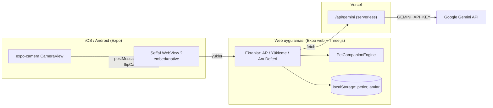

# 🐾 EternalPaws AR (Sonsuz Patiler)

Kaybettiğin ya da uzağındaki evcil hayvanını kameranın üzerinde 3D olarak canlandıran bir uygulama. Hayvan iki biçimde görünebilir: gümüş ışıktan oluşan **Patronus** formunda ya da gerçek kürküyle **Canlı** modda. Fotoğrafını yüklediğinde Gemini cinsini, kürk rengini, desenini ve göz rengini çıkarır. Şablon kedi modeli de bu bilgilere göre yeniden boyanır.

Web (Vercel), iOS ve Android'de çalışır. Arayüzün tamamı web uygulamasında. Native uygulama ise yerel kamerayı açıp web arayüzünü üstüne şeffaf bir WebView olarak bindirir.

---

## ✨ Şu an neler var

| Özellik | Durum |
| :--- | :--- |
| Prosedürel 4 ayaklı yürüyüş, nefes, kulak seğirmesi, okşanma tepkisi | ✅ |
| Patronus çağırma efekti (24.000 parçacık birleşmesi), hale, ışık buharı | ✅ |
| Canlı / Patronus mod geçişi, boyut ön ayarları, pinch ve tekerlekle ölçek | ✅ |
| Jiroskop ve sürükleme ile bakış yönü | ✅ |
| Okşayınca sentezlenmiş mırlama sesi ve titreşim (web: `navigator.vibrate`, native: köprü) | ✅ |
| Fotoğraf analizi (Gemini Vision), sunucu tarafı proxy üzerinden | ✅ |
| Kürk boyama: ana renk, ikincil renk, desen (düz / tekir / iki renk / calico / siyam), göz rengi, aura rengi | ✅ |
| Pet profillerinin cihazda saklanması, aralarında geçiş | ✅ |
| Anı Defteri: kayıtlı petler ve sohbet geçmişi | ✅ |
| Petle yazılı sohbet (Gemini) | ✅ |
| Köpek şablon modeli | ⏳ Faz 2 devamı |
| Gerçek AR (zemin algılama) | ⏳ Faz 3 |
| Hesaplar ve bulut senkronizasyonu | ⏳ Faz 4 |
| Sesli iletişim | ⏳ Faz 5 |

> Not: Şu an "AR" derken kamera görüntüsünün üzerine 3D sahne bindirilmesini kastediyoruz. Kedi gerçek zemine sabitlenmiyor. Bu iş Faz 3'te.

---

## 🏗️ Mimari



**Gemini anahtarı yalnızca sunucuda bulunur.** İstemci `/api/gemini` adresini çağırır. Kullanıcı yükleme ekranında kendi anahtarını girerse istek doğrudan Google'a gider. Ne backend ne anahtar varsa çevrimdışı varsayılan bir sonuç döner.

---

## 📂 Dizin yapısı

```
├── App.tsx                     # Ekran yönlendirme + aktif pet
├── api/gemini.ts               # Vercel serverless Gemini proxy'si
├── src/
│   ├── engine3d/
│   │   ├── PetCompanionEngine.ts   # Sahne, döngü, davranış durum makinesi
│   │   ├── CatRig.ts               # İskelet animasyonları (yürüme / idle / okşanma)
│   │   ├── ParticleSystems.ts      # Çağırma girdabı + aura parçacıkları
│   │   ├── GroundPlane.ts          # Kontak gölgesi ve ışık havuzu
│   │   ├── CameraControls.ts       # Jiroskop, sürükleme, pinch, tekerlek
│   │   ├── PetAudio.ts             # Web Audio ile sentezlenmiş mırlama
│   │   ├── furTexture.ts           # Profile göre kürk dokusu boyama
│   │   └── textures.ts
│   ├── screens/
│   │   ├── ARScreen.tsx            # Web AR ekranı (HUD + canvas)
│   │   ├── ARScreen.native.tsx     # Native: kamera + şeffaf WebView
│   │   ├── PetUploadScreen.tsx     # Fotoğraf, renk ve desen seçimi
│   │   └── MemorialScreen.tsx      # Anı Defteri
│   ├── services/
│   │   ├── geminiService.ts        # İstemci: proxy, doğrudan çağrı, çevrimdışı yedek
│   │   ├── geminiPrompts.ts        # Ortak prompt'lar ve yanıt doğrulama
│   │   └── petStorage.ts           # localStorage kalıcılığı
│   └── types/pet.ts
├── public/models/cat/          # Cat.glb şablonu (iskelet kaynağı) + dokular
├── public/models/boban/        # Boban'ın fotoğraftan üretilmiş, rig'li modeli
├── scripts/                    # 3D üretim (Hugging Face) ve Blender rig script'leri
├── legacy/                     # İlk düz HTML prototipi
└── docs/media/                 # Konsept görseller
```

---

## 🚀 Çalıştırma

```bash
npm install
cp .env.example .env
```

**Web (geliştirme):**
```bash
npm run web          # http://localhost:8081
```
`npm run web` yalnızca Metro'yu çalıştırır, `/api/gemini` bu modda yoktur ve analiz çevrimdışı yedeğe düşer. Proxy'yi de yerelde çalıştırmak istersen:
```bash
npm run build && npx vercel dev
```

**Mobil (Expo Go):**
```bash
npx expo start
```
QR kodu telefonla okut. Native uygulama, web arayüzünü Metro dev server'dan yükler. Gemini'nin çalışması için `.env` dosyasına `EXPO_PUBLIC_API_BASE=https://<vercel-adresin>` ekle.

**Yayın (Vercel):** `vercel.json` web build'ini `dist/` klasörüne çıkarır. `api/` klasörü otomatik olarak serverless fonksiyona dönüşür. Proje ayarlarına `GEMINI_API_KEY` eklemen yeterli.

---

## 📅 Yol haritası

### Faz 0: Temizlik ✅
- [x] Birebir kopya ekran dosyaları ve 3 kopya model klasörü kaldırıldı
- [x] Gemini anahtarı istemciden çıkarıldı, Vercel proxy'sine taşındı
- [x] Anı Defteri ekranı eklendi
- [x] README gerçek duruma göre yeniden yazıldı

### Faz 1: Çekirdeği sağlamlaştırma ✅
- [x] Motor modüllere bölündü
- [x] Ekran kapanınca event listener sızıntısı giderildi (`dispose()`)
- [x] Okşadıktan sonra kedinin tepki pozunda takılı kalma hatası giderildi
- [x] Mırlama sesi ve titreşim eklendi
- [x] Native ↔ WebView köprüsü (`?embed=native`, postMessage) kuruldu, `EXPO_PUBLIC_WEB_URL` ile üretim adresi tanımlanabiliyor
- [ ] Gerçek cihazlarda FPS ölçümü, gerekirse Draco sıkıştırma

### Faz 2: Fotoğraftan kişiselleştirme 🔄
- [x] Gemini'den gelen renk ve desen bilgisi şablon modelin dokularına uygulanıyor
- [x] 5 desen, ikincil renk ve aura rengi destekleniyor
- [x] Profiller cihazda saklanıyor
- [ ] Köpek şablonu (rig'li ikinci bir GLB gerekiyor)

### Faz 3: Gerçek AR
- [ ] Expo Go'dan development build'e (EAS) geçiş
- [ ] ARKit / ARCore ile zemin algılama ve dokunulan yere peti koyma (web'de WebXR yalnızca Android Chrome'da çalışıyor)
- [ ] Petle fotoğraf çekip paylaşma

### Faz 4: Hesaplar ve bulut
- [ ] Supabase ile giriş, profillerin ve anıların senkronizasyonu

### Faz 5: Ses ve Pet Brain
- [ ] Konuşmayı metne çevirme → Gemini → miyav/hav tepkisi ve animasyon
- [ ] İsmiyle seslenince başını sana çevirmesi

### Faz 6 (Ar-Ge): Fotoğraftan özgün 3D model 🔄
- [x] Hunyuan3D-2.1 (Hugging Face, ücretsiz) ile fotoğraftan mesh: `scripts/gen3d_hf.py`
- [x] Blender ile temizlik + şablon iskelete bağlama: `scripts/blender/rig_generated_cat.py`
- [x] Profil `modelUrl` ile kendi modelini kullanabiliyor (Boban: `public/models/boban/boban.glb`)
- [ ] Dokulu üretim ve dokuyu temizlenmiş mesh'e aktarma (bake)
- [ ] Gözleri yeni modelin yüzüne otomatik yerleştirme

---

**Lisans:** MIT
